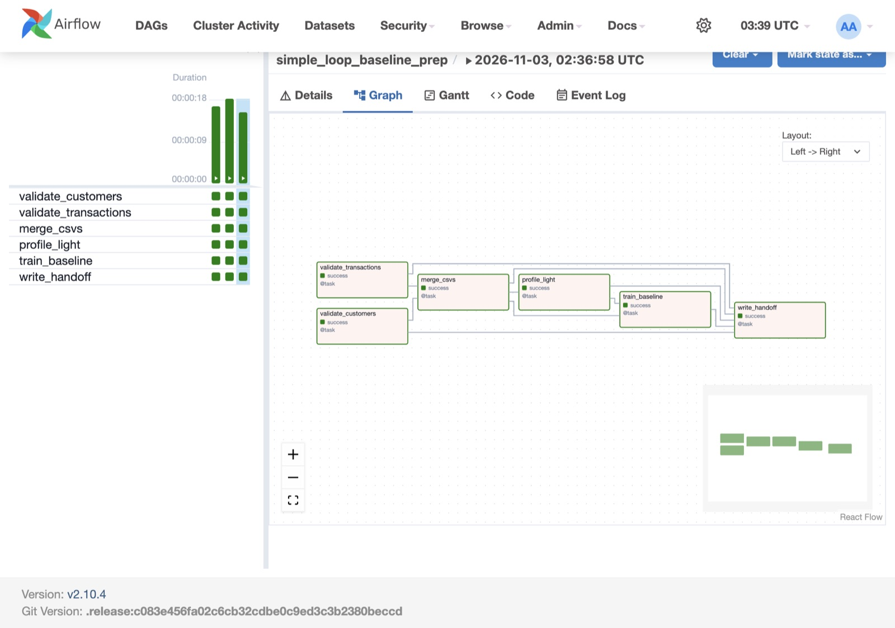
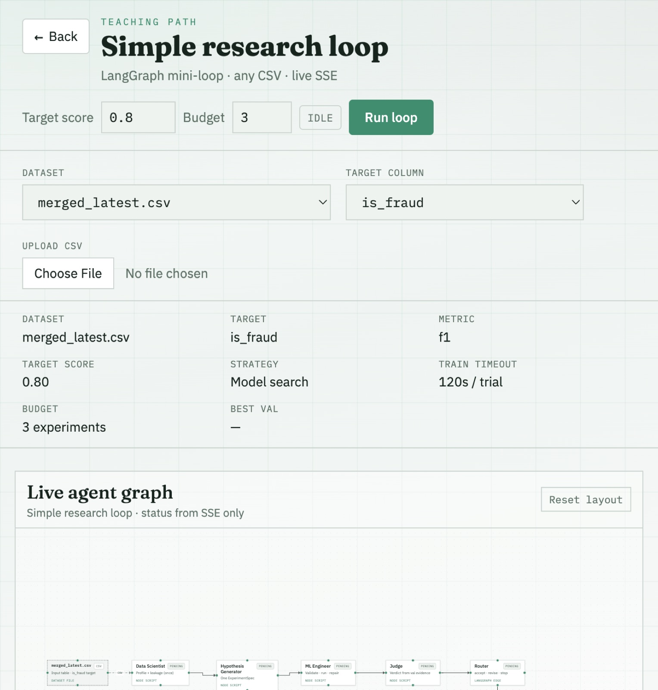

# AutoML Research Lab: Student Setup

Classroom demo in two parts:

1. **Airflow** — merge CSVs, train a baseline, publish a dataset (Docker only)
2. **LangGraph simple loop** — run the mini research loop in the UI (no Airflow required)

You can run the sections independently, or run Airflow first so `/simple-loop` can use `merged_latest.csv`.

---

## Prerequisites

| Tool | macOS | Windows |
| --- | --- | --- |
| Docker Desktop | Install from [docker.com](https://www.docker.com/products/docker-desktop/); leave it running | Same; use the WSL2 backend (recommended) |
| Python 3.12+ | Homebrew / python.org | python.org installer; check **Add python.exe to PATH** |
| Node.js 20+ | Homebrew / nodejs.org | nodejs.org LTS installer |
| Make | Xcode CLT (`xcode-select --install`) or Homebrew | Optional — Windows steps below use `docker compose` / `npm` directly |
| Git | Xcode CLT / Homebrew | [Git for Windows](https://git-scm.com/download/win) (includes Git Bash) |
| Terminal | Terminal.app / iTerm | **PowerShell** or **Git Bash** |

Do not install Airflow on the host. It runs only in Docker.

---

## One-time: clone and env

```bash
git clone https://github.com/Kedar-V/automl-research-lab.git
cd automl-research-lab
```

```bash
cp .env.example .env          # macOS / Git Bash
# Copy-Item .env.example .env # Windows PowerShell
```

`make start` / `make airflow` will create `.env` from `.env.example` if it is missing.

Edit `.env` as needed:

| Variable | Used by | Required? |
| --- | --- | --- |
| `OPENROUTER_API_KEY` | Simple loop LLM agents | Recommended (without it, nodes use fallbacks) |
| `OPENROUTER_MODEL` | Simple loop | Optional (default: `nvidia/nemotron-3.5-lightning:free`) |
| `AIRFLOW_ADMIN_USER` / `AIRFLOW_ADMIN_PASSWORD` | Airflow UI | Optional (default: `admin` / `admin`) |
| `CURSOR_API_KEY` | Simple/student loop when Model = Cursor SDK; also full multi-agent stack | Optional |
| `WANDB_*` | Full multi-agent stack only | Optional |

Keep secrets in `.env`. Never commit real keys.

---

## Quick start — web app (one command)

Docker Desktop must be running. From the repo root:

```bash
make start
```

That will:

1. Ensure `.env` exists
2. Build/start the Docker stack (gateway + services)
3. Wait until `http://127.0.0.1:8000/healthz` is up
4. `npm install` + start Vite

Then open **[http://127.0.0.1:5173](http://127.0.0.1:5173)**

Useful routes once the UI is up:

| Route | What |
| --- | --- |
| [/guide](http://127.0.0.1:5173/guide) | Student guide (Airflow + LangGraph copyable steps) |
| [/simple-loop](http://127.0.0.1:5173/simple-loop) | Instructor mini-loop |
| [/student-loop](http://127.0.0.1:5173/student-loop) | Student Build Loop lab |

`Ctrl+C` stops Vite only. Tear down Docker with `make down`.

### Windows — web app (no Make)

```powershell
if (-not (Test-Path .env)) { Copy-Item .env.example .env }
docker compose -f infra/docker-compose.yml --env-file .env up --build -d
# wait until this succeeds (retry for 1–2 min on first build):
Invoke-RestMethod http://127.0.0.1:8000/healthz
cd frontend
npm install
npm run dev
```

Open [http://127.0.0.1:5173](http://127.0.0.1:5173).

---

## Section 1: Set up Airflow

Goal: start Airflow in Docker, confirm the UI + DAGs, run prep, publish a subset CSV for later use.

### Steps (macOS / Make)

1. Make sure **Docker Desktop** is running.
2. From the **repo root**, ensure `.env` exists (`cp .env.example .env` if needed).
3. Start the Airflow profile:

```bash
make airflow
```

Equivalent:

```bash
docker compose -f infra/docker-compose.yml --env-file .env --profile airflow up --build -d
```

4. **Wait 1–2 minutes** (longer on first build). Confirm containers:

```bash
docker compose -f infra/docker-compose.yml --env-file .env --profile airflow ps
```

`airflow-webserver` should be healthy / running before you open the UI.

5. Open [http://localhost:8088](http://localhost:8088) and log in with `admin` / `admin` (unless `.env` overrides).
6. Confirm the DAG list has:
   - `student_baseline_prep` — student lab (empty Graph until wired)
   - `simple_loop_baseline_prep` — instructor / filled reference
   - `simple_loop_baseline_and_trigger` — later reveal (stub)

Docker only. Do not install Airflow on your host.

**Run prep (UI):** unpause `simple_loop_baseline_prep` → Trigger → Graph tab (tasks turn green).



**CLI alternative (still Docker):**

```bash
docker compose -f infra/docker-compose.yml --env-file .env --profile airflow run --rm airflow-prep-once
```

**Confirm publish**

```bash
ls -la datasets/airflow/merged_latest.csv
ls -la artifacts/airflow/runs/
```

**Stop Airflow** (also stops the main stack if it was up):

```bash
make down
```

### Windows — Airflow

```powershell
if (-not (Test-Path .env)) { Copy-Item .env.example .env }
docker compose -f infra/docker-compose.yml --env-file .env --profile airflow up --build -d
```

Wait 1–2 minutes, then:

```powershell
docker compose -f infra/docker-compose.yml --env-file .env --profile airflow ps
```

**UI:** [http://localhost:8088](http://localhost:8088) — `admin` / `admin`  
Same DAGs as above.

**Run prep (UI):** unpause `simple_loop_baseline_prep` → Trigger → Graph.

**CLI alternative:**

```powershell
docker compose -f infra/docker-compose.yml --env-file .env --profile airflow run --rm airflow-prep-once
```

**Confirm publish**

```powershell
Get-Item datasets\airflow\merged_latest.csv
Get-ChildItem artifacts\airflow\runs\
```

**Stop**

```powershell
docker compose -f infra/docker-compose.yml --env-file .env --profile airflow down
```

What the prep DAG does:

`customers.csv` ⨝ `transactions.csv` → subset (~2000 rows) → train baseline → publish

More detail: [`airflow/README.md`](airflow/README.md) · data: [`datasets/airflow/ATTRIBUTION.md`](datasets/airflow/ATTRIBUTION.md)

---

## Section 2: LangGraph simple loop

Goal: run the mini LangGraph loop at `/simple-loop`.

**macOS:** `make start` (see Quick start) is enough — backend + UI.

Then open [http://127.0.0.1:5173/simple-loop](http://127.0.0.1:5173/simple-loop)

- After Section 1: dataset `merged_latest.csv`, target `is_fraud`
- Without Airflow: e.g. `Titanic-Dataset.csv`, target `Survived`



**Optional checks**

```bash
make health
curl -s http://127.0.0.1:8000/simple-loop/info | python3 -m json.tool
```

**Backend only** (no Vite): `make up` then `make health`  
**Frontend only** (stack already up): `make frontend`

**Stop:** `Ctrl+C` in the Vite terminal, then `make down`.

**CLI only (optional)** — needs local install once: `make install`

```bash
.venv/bin/python mini_loop/run_cli.py \
  --dataset datasets/Titanic-Dataset.csv \
  --target Survived \
  --max-cycles 3
```

### Windows — simple loop

Same as **Windows — web app** above, then open `/simple-loop`.

```powershell
foreach ($port in 8000,8011,8002,8003,8004,8005,8006) {
  Write-Host -NoNewline "localhost:$port -> "
  try {
    Invoke-RestMethod "http://127.0.0.1:$port/healthz" | Out-Null
    Write-Host "ok"
  } catch {
    Write-Host "FAIL"
  }
}
```

**Stop**

```powershell
docker compose -f infra/docker-compose.yml --env-file .env down
```

**CLI only (optional)**

```powershell
python -m venv .venv
.\.venv\Scripts\pip install -e ".[dev]"
.\.venv\Scripts\python mini_loop\run_cli.py `
  --dataset datasets\Titanic-Dataset.csv `
  --target Survived `
  --max-cycles 3
```

---

## Suggested classroom order

| Order | What | Outcome |
| --- | --- | --- |
| 1 | Airflow **student** DAG `student_baseline_prep` | Fill [`airflow/dags/student_baseline_prep.py`](airflow/dags/student_baseline_prep.py), wire deps → Graph fills → run |
| 2 | (Optional reveal) instructor DAG | Baseline + `merged_latest.csv` via `simple_loop_baseline_prep` |
| 3 | LangGraph **Build Loop** | Fill [`student_loop/graph.py`](student_loop/graph.py) → `/student-loop` empty until ready → Run |
| 4 | (Optional reveal) `/simple-loop` | Instructor mini-loop on the same CSV |
| 5 | (Later) `simple_loop_baseline_and_trigger` | Reveal how Airflow could call the loop |

Guide UI: [http://127.0.0.1:5173/guide](http://127.0.0.1:5173/guide) after `make start`.

### Build Loop (student LangGraph)

With the web app running:

1. Follow [`student_loop/COPY_GUIDE.md`](student_loop/COPY_GUIDE.md) — paste into [`student_loop/graph.py`](student_loop/graph.py) one step at a time
2. Open [http://127.0.0.1:5173/student-loop](http://127.0.0.1:5173/student-loop)
3. **Refresh graph**, then **Run loop**

**macOS status check:** `python -m student_loop.run_cli --status` (after `make install`)  
**Windows status check:** `.\.venv\Scripts\python -m student_loop.run_cli --status`

### Airflow student DAG

After Airflow is up, open the UI and find `student_baseline_prep`. The Graph tab stays empty until the wiring block in [`airflow/dags/student_baseline_prep.py`](airflow/dags/student_baseline_prep.py) is uncommented. Copy steps: [`airflow/dags/COPY_GUIDE.md`](airflow/dags/COPY_GUIDE.md) or the in-app guide.

---

## Useful ports

| What | URL |
| --- | --- |
| Frontend | http://127.0.0.1:5173 |
| Gateway API | http://127.0.0.1:8000 |
| Airflow UI | http://localhost:8088 |
| MLflow (full stack) | http://127.0.0.1:5050 |

## Make targets (macOS)

| Target | What |
| --- | --- |
| `make start` | Ensure `.env`, Docker stack, wait for gateway, Vite UI |
| `make airflow` | Start Airflow profile (UI on :8088) |
| `make up` | Docker stack only |
| `make health` | Curl service `/healthz` ports |
| `make frontend` | Vite only (stack already up) |
| `make down` | Stop Docker (including Airflow profile) |
| `make install` | Local `.venv` + editable install (CLI / tests) |

---

## Full multi-agent lab (not required for the two demos above)

### macOS

```bash
cp .env.example .env   # set MOCK_*=false for live research
make start
```

### Windows (PowerShell)

```powershell
Copy-Item .env.example .env   # then edit MOCK_*=false for live research
docker compose -f infra/docker-compose.yml --env-file .env up --build -d
cd frontend; npm install; npm run dev
```

Upload `datasets/churn_sample.csv`, target `churned`.  
Design canvas: [`AutoML_Research_Lab_demo_canvas.pdf`](AutoML_Research_Lab_demo_canvas.pdf) · mock script: [`docs/DEMO_SCRIPT.md`](docs/DEMO_SCRIPT.md)
